# Hannigan 操作マニュアル（Phase 3: 同じ Mac でハブとワーカーを動かす構成）

作成日: 2026-10-17。画面は本物の Claude Code v2.1.301 で動かして撮影した（秘書・PM・子はすべて `--effort low`）。
対象: WebChat から統括秘書に仕事を頼み、案件 PM と子セッションの進み具合を見て、承認や停止をする人。
画面を撮り直すときは `bun scripts/manual-shots.ts <出力先>`（本物の Claude を使う。設定画面だけなら `--settings-only` で利用枠を使わない）。

## 0. 用語

| 用語 | 意味 |
| --- | --- |
| ハブ | WebChat を配信し、秘書とワーカーの間を中継するプログラム。Phase 3 では手元の Mac で動く |
| 統括秘書（秘書） | WebChat の会話ごとに 1 つ起動する Claude Code。依頼の内容から担当の Mac と案件を選び、PM に指示する |
| ワーカー | 作業 Mac で動く常駐プログラム。Claude Code を tmux の中で起動・停止し、結果をハブへ返す |
| 案件 PM（PM） | 案件（フォルダ）ごとに 1 つの Claude Code。軽い作業は自分で行い、大きい作業は子セッションに任せる |
| 子セッション（子） | PM が作る作業用の Claude Code。報告は PM に届く |
| 承認カード | ツール実行や起動時の確認を WebChat に出したもの。ボタンで答える |
| 書込権 | 同じフォルダを書けるセッションを 1 つに絞る仕組み。順番待ちになると画面に「資源待ち」と出る |

## 1. 初回の準備（1 回だけ）

必要なもの: macOS、Bun 1.3 以降、tmux、claude.ai にログイン済みの Claude Code。

```bash
cd <リポジトリ>
bun install
scripts/start.sh
```

`start.sh` は設定が無ければ `~/.hannigan` に設定と鍵を作ってから、ハブとワーカーを tmux で起動する。最後に次のような 1 行が出る。

```text
WebChat (keep private): http://127.0.0.1:8800/#token=...
```

この URL をブラウザで開く。`#token=` の後ろは合言葉なので人に見せない。URL は 1 回開けばブラウザが覚える。

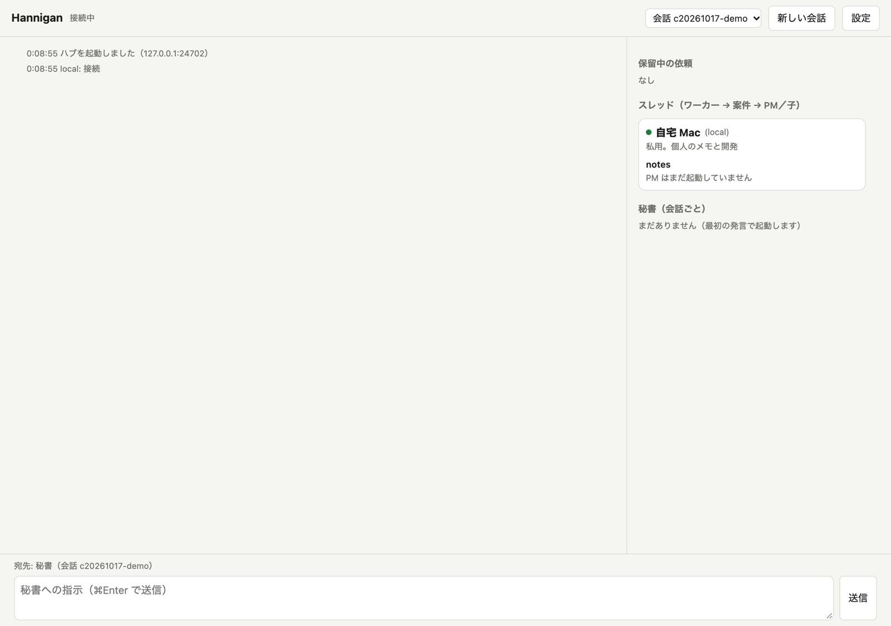

右側の「スレッド」にワーカー（この Mac）と案件が出る。案件がまだ無いときは、2 章の設定画面で追加する。

## 2. 案件（フォルダ）を登録する

右上の「設定」を押す。上がハブの設定、下がワーカーごとの案件の設定。

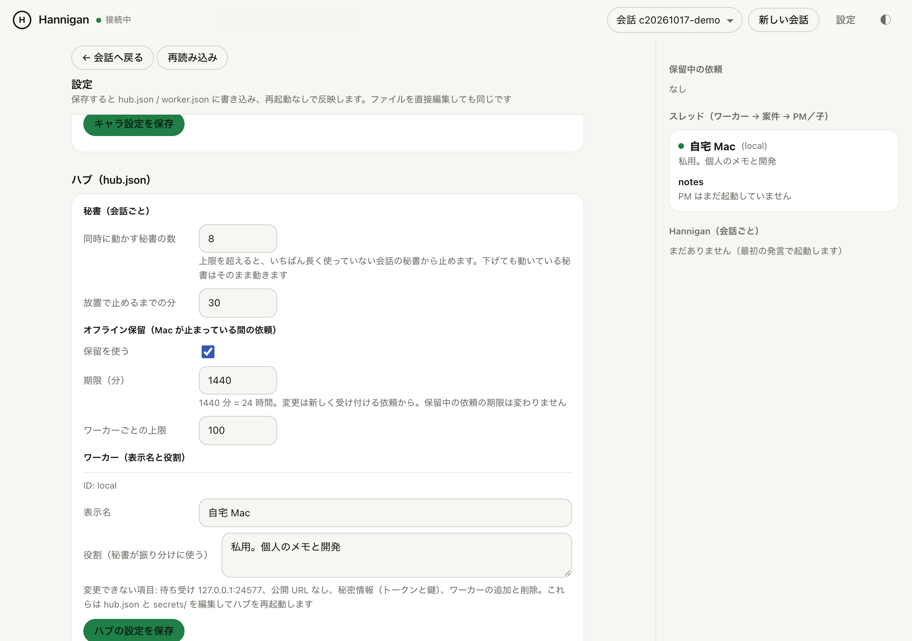

| 項目 | 意味 | 変えるとき |
| --- | --- | --- |
| 同時に動かす秘書の数 | 会話ごとの秘書の上限。超えると、いちばん長く使っていない会話の秘書から止める | 利用枠を抑えたいとき |
| 放置で止めるまでの分 | 入力待ちの秘書を止めるまでの時間。再開は自動で履歴も残る | 既定の 30 分でよい |
| 保留を使う、期限、上限 | Mac が落ちている間の依頼をハブが預かる設定。期限は受付からの分数で、既定は 24 時間 | 普段は有効のまま |
| 表示名、役割 | 秘書が「どの Mac に振るか」を決める材料。役割は文章で書く | Mac を増やしたとき |

下へスクロールすると案件の一覧がある。

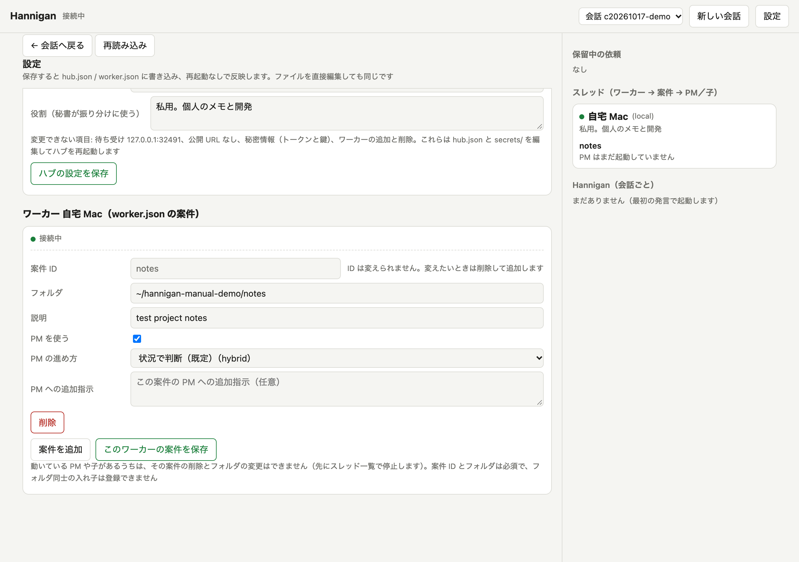

「案件を追加」を押して、案件 ID（英数字）、フォルダ（Mac 上の既存のフォルダ。`~/work/blog` のように書ける）、説明を入れ、「このワーカーの案件を保存」を押す。

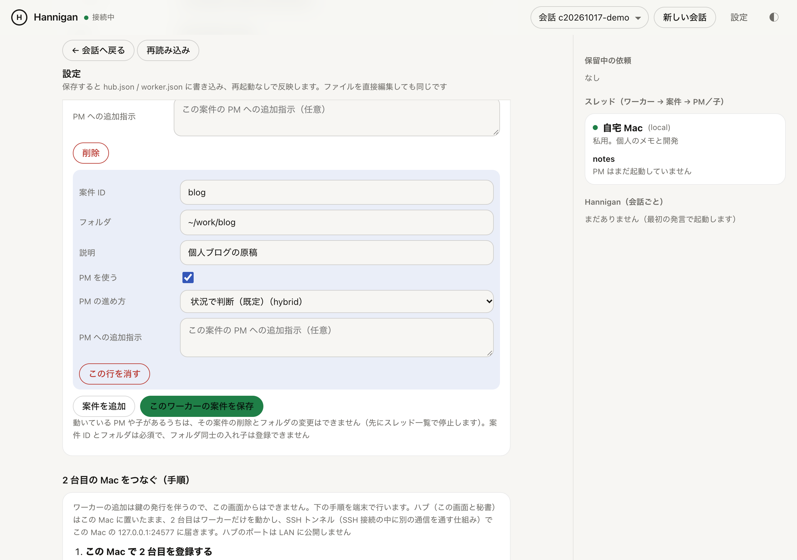

保存は即座に反映され、再起動はいらない。次のときは保存が断られる。

- フォルダが存在しない、相対パスで書いた
- 案件同士のフォルダが同じか入れ子になっている（書込権がフォルダ単位のため）
- PM や子が動いている案件を削除、またはフォルダを変更しようとした。先にスレッド一覧の「停止」で止める

「PM を使う」を外すと、その案件は PM 無しの Phase 2 方式（秘書が子を直接作る）になる。「PM の進め方」は、PM が自分で作業するか子に任せるかの基準で、既定の「状況で判断」でよい。

## 3. 仕事を頼む

会話画面の下の欄に、人に頼むように書いて送信する。案件 ID を文に入れると秘書が迷わない。

例: 「自宅 Mac の notes で、TODO.md を作って『買い物リストを作る』『来週の予定を整理する』の 2 行を書いて。小さい作業なので PM 自身でやって。終わったら一言で教えて」

### 3.1 起動時の確認に答える

その会話で初めて送ると秘書が起動し、承認カードが 2 枚出る。「フォルダの信頼確認」は trust を選ぶボタン、「開発用チャネルの起動確認」は「I am using this for local development」を押す。PM が起動するときにも同じカードが出る。

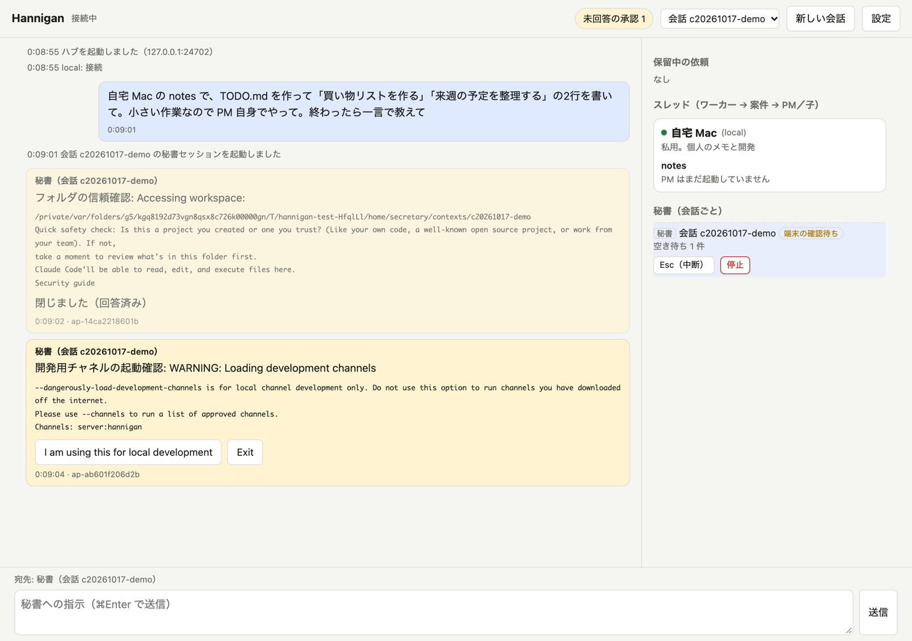

右上の「未回答の承認 N」を押すと、答えていないカードへ飛ぶ。

### 3.2 ツールの承認

PM や子がファイルを書くときや、コマンドを実行するときに承認カードが出る。内容を見て「許可」か「拒否」を押す。拒否すると PM はその操作をあきらめて報告する。

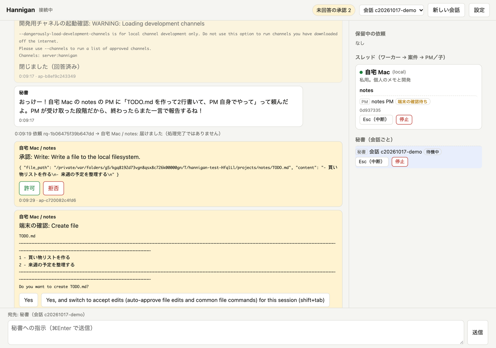

同じ操作で端末側にも「Create file」のような確認が出ることがある。これは Claude Code 本体の確認で、WebChat の承認を押すと端末側も進む。カードに「閉じました（画面から消えた）」と出れば答える必要はない。

### 3.3 結果が返る

PM が終わると「PM からの報告」が畳まれた形で出て、その下に秘書の返事が来る。報告の行を押すと PM の原文が開く。

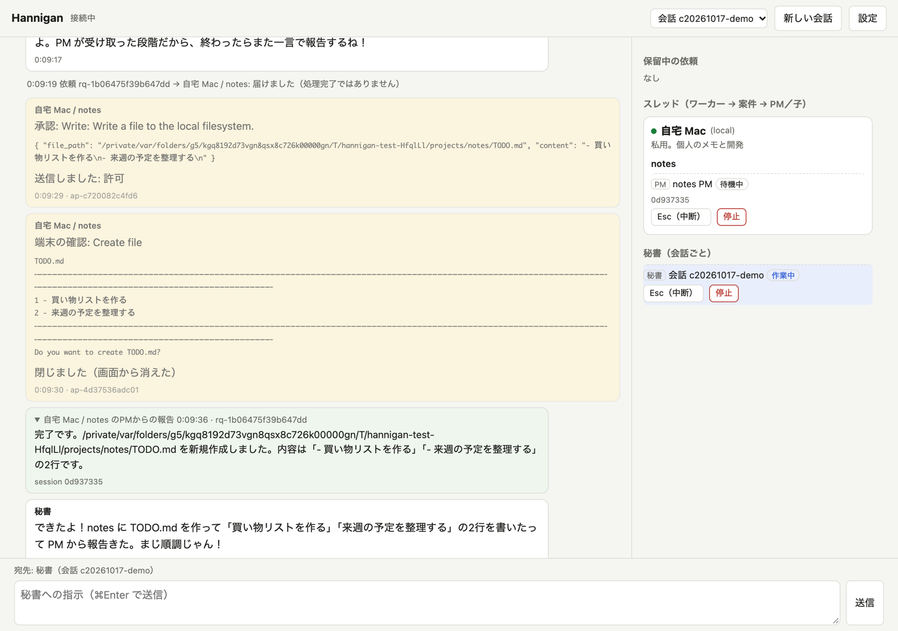

薄い灰色の行は配送の記録。「届けました（処理完了ではありません）」は PM が受け取っただけの状態で、完了は報告で分かる。

### 3.4 PM が子に任せる

長い作業や並列の作業は、PM が子セッションを作って任せる。右側のスレッド一覧に子が増え、子の報告は PM に届き、PM がまとめて元の会話に返す。

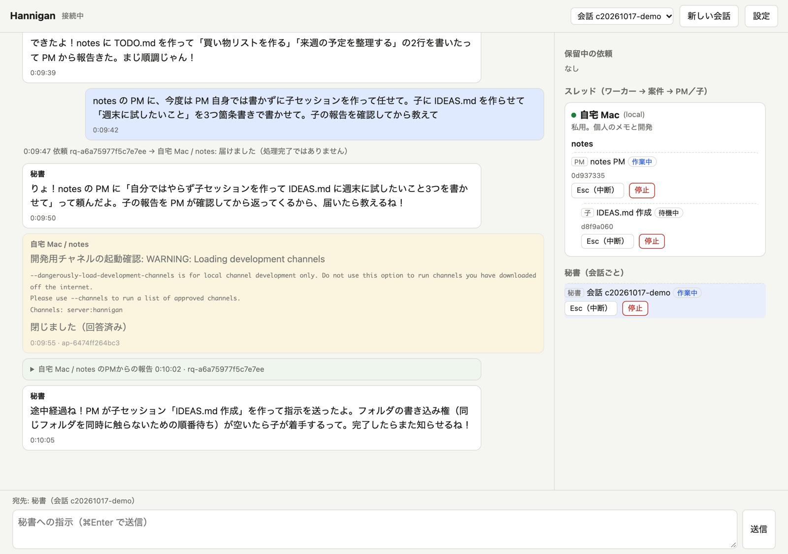

PM と子は同じフォルダを共有するので、片方が書いている間はもう片方は「資源待ち」になる。順番は自動で回る。

## 4. 進み具合を見る、直接口を挟む

右側のスレッド一覧で PM か子を押すと、そのセッションの履歴が出る。Claude Code の会話記録から発言、ツールの要約、ツールの結果を取り出して表示する（思考は出さない。秘密情報らしい文字列は伏せる）。

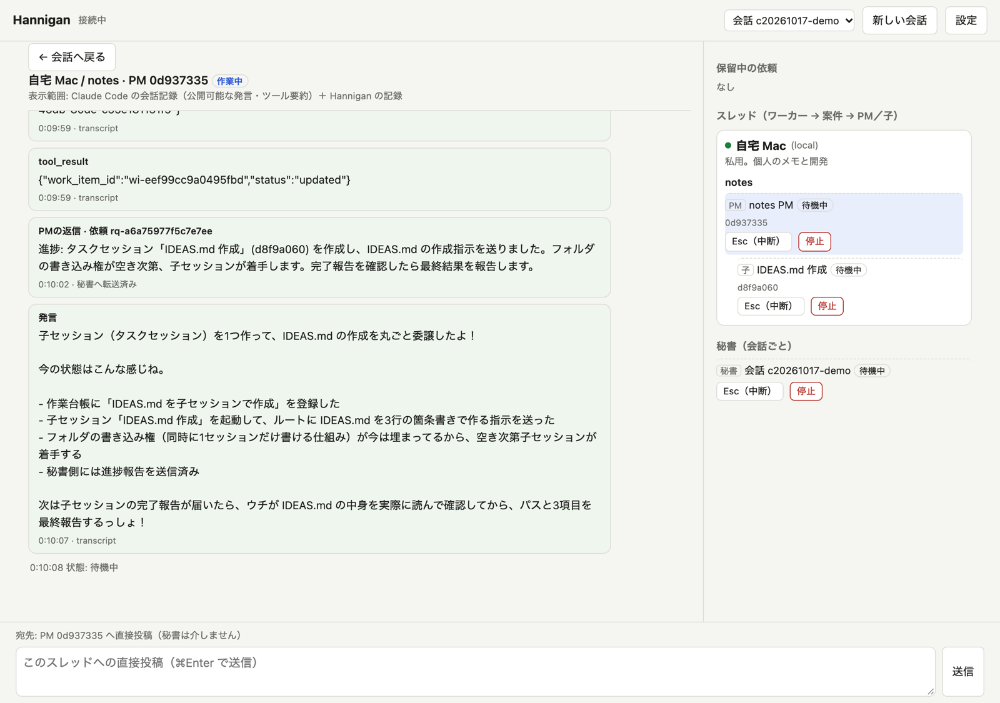

下の入力欄はこのスレッドへの直接投稿になり、秘書を通さずに PM に届く。子に投稿すると PM にも通知が行く。返事はこのスレッドに残り、秘書の会話には流れない。

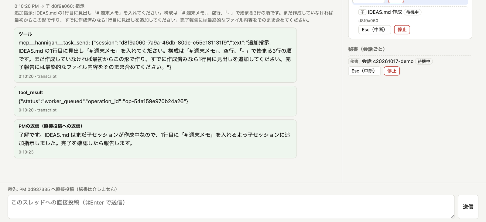

「← 会話へ戻る」で秘書との会話に戻る。

## 5. Mac が止まっているときの依頼

ワーカーが落ちている間に依頼すると、ハブが預かって「保留中（Mac オフライン）」と出る。右側の「保留中の依頼」に並び、「取消」で取り下げられる。期限（既定 24 時間）を過ぎると実行されずに失効し、会話に通知が出る。

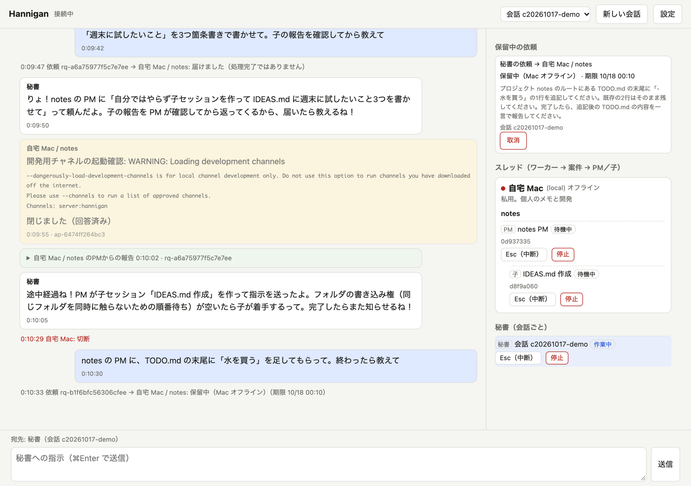

ワーカーが戻ると受付順に配送され、通常どおり PM が動いて報告が返る。

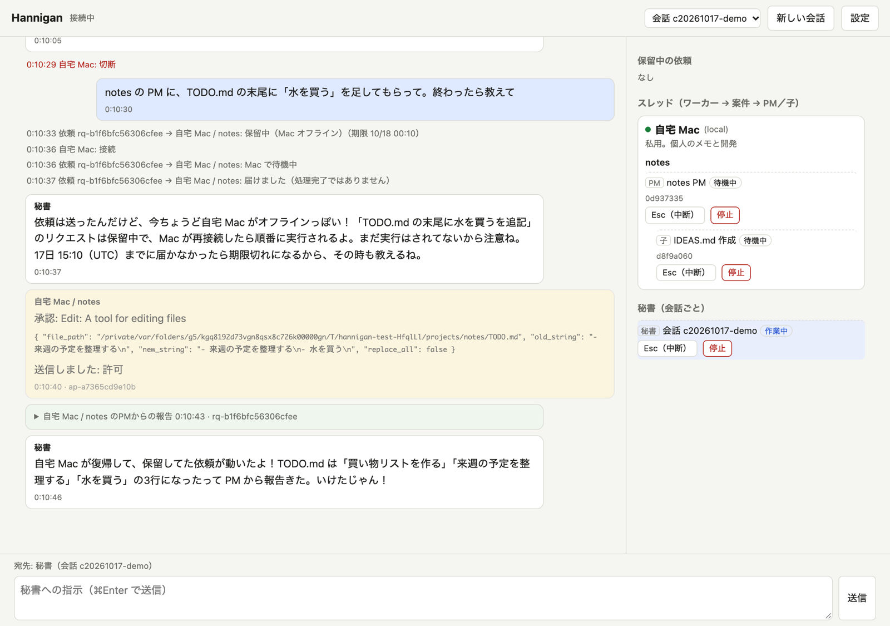

## 6. 止める、やり直す

スレッド一覧の各行にボタンがある。

| ボタン | 動き |
| --- | --- |
| Esc（中断） | 端末に Esc を送る。どこまで進んだかはスレッドで確認する |
| 停止 | セッションを終える。PM は次の依頼で履歴ごと再開する。秘書も同じ |

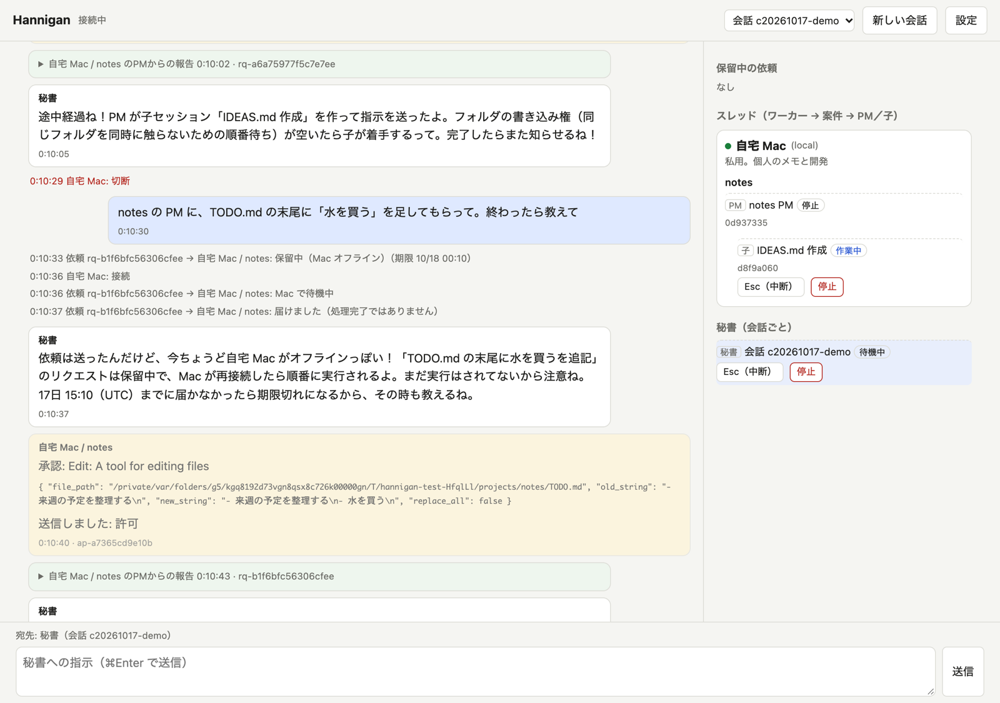

書込権を持ったまま止められたセッションがあると、右側に赤い「要確認」の帯が出る。これは「作業が終わったか確かめられない」状態で、自動では解放しない。そのスレッドを開いて様子を見て、終わっていれば停止ボタンで止める。

## 7. スマホで見る

画面幅が狭いと右側の一覧は隠れ、上の「スレッド」ボタンで開閉する。使い方は同じ。

| 会話画面 | スレッド一覧 |
| --- | --- |
| 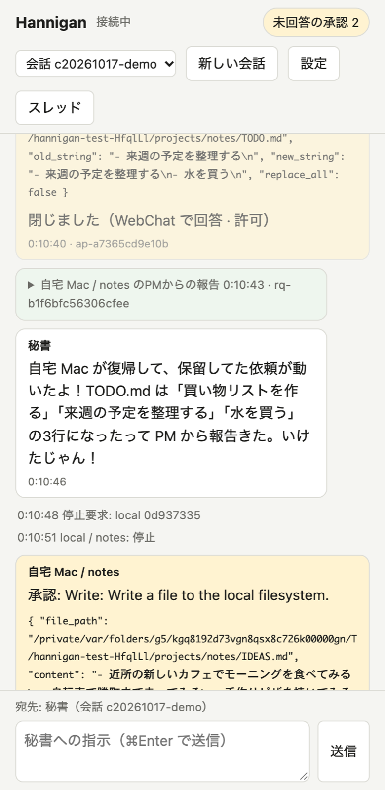 | 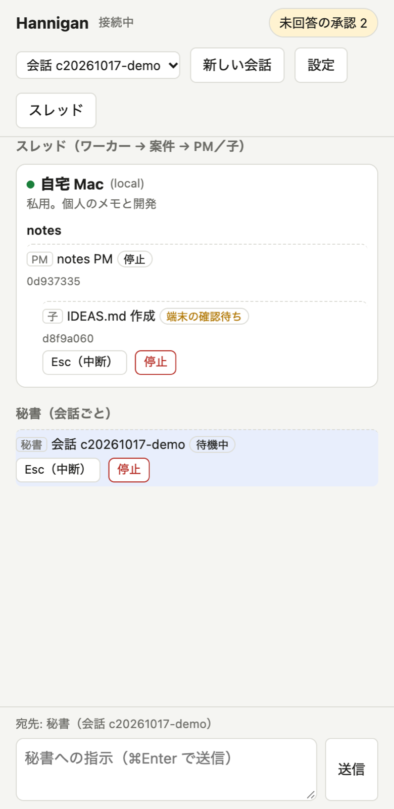 |

## 8. 毎日の起動と終了

```bash
scripts/start.sh             # ハブとワーカーを起動。URL を表示
scripts/stop.sh              # ハブとワーカーだけ止める。Claude のセッションは tmux に残る
scripts/stop.sh --sessions   # 秘書・PM・子も /exit で終える
```

普段は `stop.sh` だけでよい。次の起動で秘書と PM は履歴ごと再開する。Mac の再起動前や Claude Code の更新後は `--sessions` で全部終える。

## 9. 困ったとき

| 症状 | 見る場所と対処 |
| --- | --- |
| 画面が「未接続」のまま | `tmux ls` に `hn-hub` と `hn-worker` があるか。無ければ `scripts/start.sh` |
| 秘書や PM が返事しない | `tmux attach -t hn-<案件>-<ID 先頭 8 桁>` で端末を直接見る。端末にしか出ない確認（Computer Use のアプリ承認など）が出ていることがある。見終わったら `Ctrl-b d` で抜ける |
| 承認カードが「閉じました（期限切れ）」になった | セッションを開き直すか、同じ依頼をもう一度送る |
| 赤い「要確認」の帯 | 6 章。該当スレッドを見て停止する |
| 原因を追いたい | `~/.hannigan/logs/hub.log` と `worker.log`。ハブの記録は `~/.hannigan/hub/`、ワーカーの記録は `~/.hannigan/worker/` |

## 10. 注意

- Claude Code Channels と純正 Computer Use は研究プレビュー。起動のたびに開発用チャネルの確認が出る
- 秘書・PM・子の 3 役ぶん利用枠を使う。最初は案件 1〜2 個で様子を見る
- トークン付きの URL と `~/.hannigan/secrets/` は人に見せない
- 画面に出る案件フォルダの場所は、この Mac の中でだけ使う。ハブの記録（イベント）には残らない
