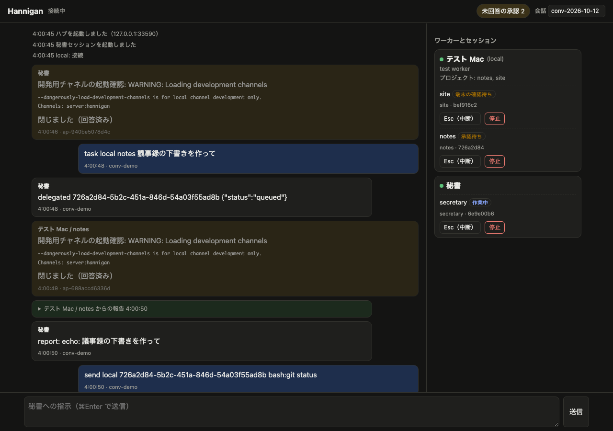

# Phase 2: 1 台構成の一巡試験

実施日: 2026-10-13（JST）
実施者: Claude Code（自律実行）。人の操作はなし。WebChat の操作は試験スクリプトが API で代行した
環境: Mac mini（macOS 26.5.1、arm64）、Claude Code v2.1.296（claude.ai 認証、Max）、Bun 1.3.9、tmux 3.8
証拠: [`evidence/`](evidence/)（一時フォルダの場所と利用者名は伏せた）

## 結論

Phase 2 の出口条件 3 つを、本物の Claude Code で確認した。

| 出口条件 | 結果 | 根拠 |
| --- | --- | --- |
| WebChat の 1 往復で、秘書がセッションを作って指示し、結果が同じ会話に戻る | 達成 | 本物の試験の 2〜3 行目、自動試験 |
| 通常ツールの承認が WebChat から許可・拒否できる | 達成 | 本物の試験の 4〜5 行目、自動試験 |
| セッションの再開で履歴とチャネル登録が維持される | 達成 | 本物の試験の 7〜8 行目、自動試験 |

本物の試験で、停止直後に再開したセッションが 10 秒後に終了する不具合が見つかった。原因を直し、偽 Claude の自動試験に再発防止の試験を加えた。
修正後、2026-10-14 に本物で再試験し、8 項目すべて PASS した（1.1 節）。

## 1. 本物の Claude Code での一巡（`test/e2e-real.ts`）

秘書とワーカーはどちらも `--effort low` で起動した。承認カードへの回答は、試験スクリプトが人の代わりに `POST /api/answer` で行った（[`evidence/answers.log`](evidence/answers.log)）。

| # | 確かめたこと | 結果 | 時刻（UTC） |
| --- | --- | --- | --- |
| 1 | 秘書が起動し、フォルダの信頼確認と開発用チャネルの起動確認を WebChat から回答して ready になった | PASS | 18:54:23〜18:54:28 |
| 2 | 「e2e プロジェクトで hello.txt を作って」と送ると、秘書がセッションを作って指示し、ワーカーが作業して報告した。ファイルの中身は `hannigan-e2e-ok` | PASS | 18:54:28〜18:55:08 |
| 3 | 秘書が報告を同じ会話（`conv-e2e`）へ返した | PASS | 18:55:12 |
| 4 | ワーカーの Bash 承認を WebChat から許可した（承認カードは `webchat:allow` で閉じた） | PASS | 18:54:57 |
| 5 | `touch denied-marker.txt` の Bash 承認を WebChat から拒否した。ファイルは作られず、ワーカーは代わりの手段を使わずに報告した | PASS | 18:55:25 |
| 6 | 停止 API（WebChat の停止ボタンと同じ）でセッションを終えた | PASS | 18:55:48〜18:55:50 |
| 7 | 秘書に再開を頼むと `session_resume` で再開し、停止前に覚えさせた合言葉 `ゆうぐれ-3564` を答えた | PASS | 18:55:53〜18:56:14 |
| 8 | 再開したセッションからチャネル経由で報告が届いた（チャネル登録の維持） | PASS | 18:56:14 |

7 の途中で、再開したセッションが 18:55:58 に `exited` になった。秘書はこの知らせを受けて自分でもう一度再開し、2 回目で合言葉を得た。原因は 3 章に書く。

### 1.1 修正後の再試験（2026-10-14）

同じ `test/e2e-real.ts` を `--effort low` で再実行した（07:10〜07:11 JST、Claude Code v2.1.296）。証拠は [`evidence-rerun-20261014/`](evidence-rerun-20261014/)。

| 確かめたこと | 結果 |
| --- | --- |
| 1〜8 の全項目 | PASS |
| 停止後の再開 | 1 回目の再開で合言葉 `ゆうぐれ-6510` を答えた。初回の試験では再開したセッションが `exited` になり、秘書が 2 回目の再開をしていた |

時刻は次のとおり（UTC）。停止開始 22:11:16.4、`stopped` 22:11:18.8、再開 22:11:21.5、報告 22:11:27.1。
前回の停止処理の強制終了タイマーは 22:11:26 頃に動く計算で、その後の報告まで `exited` は出なかった。
ただし試験はこの報告の直後に片付けへ進むため、タイマー後の観察は 1 秒ほどしかない。11 秒の待ちを入れた確認は偽 Claude の自動試験で行っている。

### 実測で分かったこと

- 秘書を `--tools ""`（組み込みツールなし）で起動しても、チャネルのツール（`mcp__hannigan__*`）は使えた。秘書は振り分けだけを行う
- `--allowedTools mcp__hannigan` で秘書のツールは承認なしに呼べた。ワーカーの返信ツールも `mcp__hannigan__reply` の指定で承認なしになった
- 開発用チャネルの起動確認は、新規起動のたびと再開のたびに出た。フォルダの信頼確認は新しいフォルダで最初の 1 回だけ出た
- 作業中の画面表示は `✽ Hashing… (11s · ↓ 448 tokens)` の形で、`esc to interrupt` は出なかった。状態判定がこれを拾えず、秘書が作業中でも `ready` と表示される場面があった。判定を直し、単体試験を加えた
- 秘書は会話の言葉づかいに利用者の出力スタイル（ユーザー設定）をそのまま使った。ユーザー設定のフックや出力スタイルは作業セッションにも効く

## 2. 偽 Claude での自動試験（`bun test`）

`test/fake-claude.ts` は、Hannigan が頼っている Claude Code の振る舞いだけをまねる。端末ダイアログ、`--mcp-config` で渡したブリッジの起動、チャネル通知、承認の中継、作業中の表示、Esc、`/exit` を再現する。
利用枠を使わないので、何度でも回せる。ハブ、ワーカー常駐プログラム、tmux は本物を使う。

| 試験 | 中身 |
| --- | --- |
| 秘書の起動 | 信頼確認と起動確認を WebChat から回答 |
| 1 往復 | 作成、指示、報告、秘書の返信が同じ会話に戻る。ワーカーの起動確認は `auto_accept` の設定で自動回答 |
| 重複送信 | 同じ `msg_id` は無視 |
| 承認の許可と拒否 | WebChat から回答し、結果がワーカーの報告に反映 |
| 閉じた承認への回答 | 404 で断る |
| 中断（Esc） | 実行中の作業が止まり、同じセッションで続けられる |
| 停止と再開 | 履歴とチャネルが残る。再開後 11 秒たっても前回の停止処理で終了しない（3 章の再発防止） |
| 状態の取得 | ワーカー、セッション、未回答の承認 |
| ワーカー常駐プログラムの再起動 | 停止中は秘書に `worker_offline` が返る。再起動後、動いていたセッションをそのまま引き継ぐ |
| ハブの再起動 | ハブ停止中に出た報告が outbox から 1 回だけ届く。秘書のブリッジも再接続する |
| SSE の再生 | `since` の続きから欠けなく流れる（ブラウザの再接続） |
| 認証 | WebChat のトークン違いは 401、ワーカーの鍵違いは切断 |
| 不正な命令 | 存在しないプロジェクトは `not_found` |
| 停止 | tmux のセッションが消える |

単体試験は 17 件（画面読み取り、設定、outbox）。結果は 2026-10-13 時点で全件成功。

```text
bun test test/unit       17 pass
bun test test/e2e-fake   15 pass（3 回連続）
```

## 3. 見つけた不具合と修正

| 不具合 | 原因 | 修正 | 確認 |
| --- | --- | --- | --- |
| 停止直後に再開したセッションが 10 秒後に終了する | 停止処理は 10 秒後に tmux が残っていれば強制終了する。再開は同じ tmux 名を使うので、前回の停止処理が新しいセッションを終了させた | 停止処理のタイマーが、自分の起動回のときだけ動くようにした | 自動試験に再発防止の試験を加えた。修正を外すと失敗し、戻すと成功することを確かめた |
| 秘書が作業中でも `ready` と表示される | v2.1.296 の作業中表示に `esc to interrupt` がない | 作業中表示の行（記号＋語＋`…`）も判定に使う | 単体試験（実物の表示文字列） |
| ブリッジ接続直後の指示が消える（偽 Claude で発見） | MCP の初期化完了前に書いた通知は受け手が捨てる | ブリッジは `notifications/initialized` を受けて 1 秒後に準備完了を名乗る | 自動試験 |

## 4. 画面

偽 Claude で動かした WebChat の画面（幅 1280px）。承認カード、ワーカーの報告、右側のワーカーとセッションの一覧と Esc・停止ボタンを表示している。



ヘッドレス Chrome は幅 500px 未満で描画できないため、スマホ幅の見た目は撮れていない。画面は幅 860px 以下でセッション一覧を「ワーカー」ボタンの裏に畳む作りにしてある。

## 5. 確かめていないこと

- 中断（Esc）、ワーカー常駐プログラムとハブの再起動、SSE の再生は偽 Claude でのみ確認した
- 純正 Computer Use を使う作業は試していない（Phase 2 の出口条件に含まれない）。CU のアプリ承認は画面読み取りで承認カードになる作りだが、本物では未確認
- 別端末・別ネットワークからの利用は Phase 3 で行う
